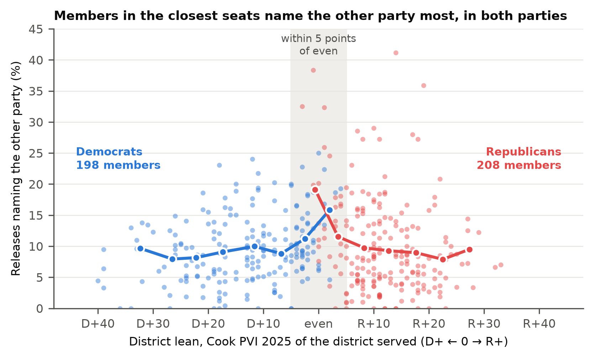
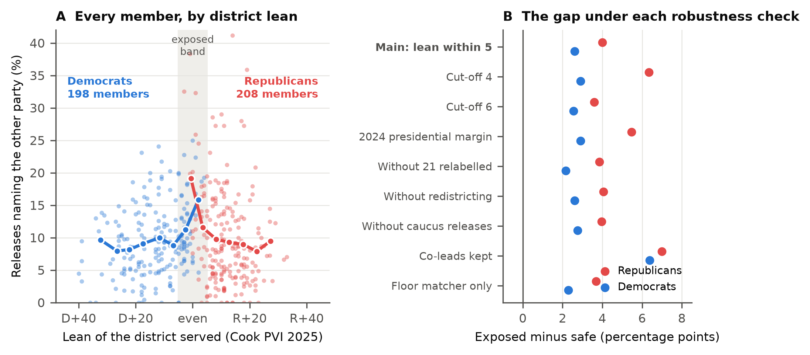
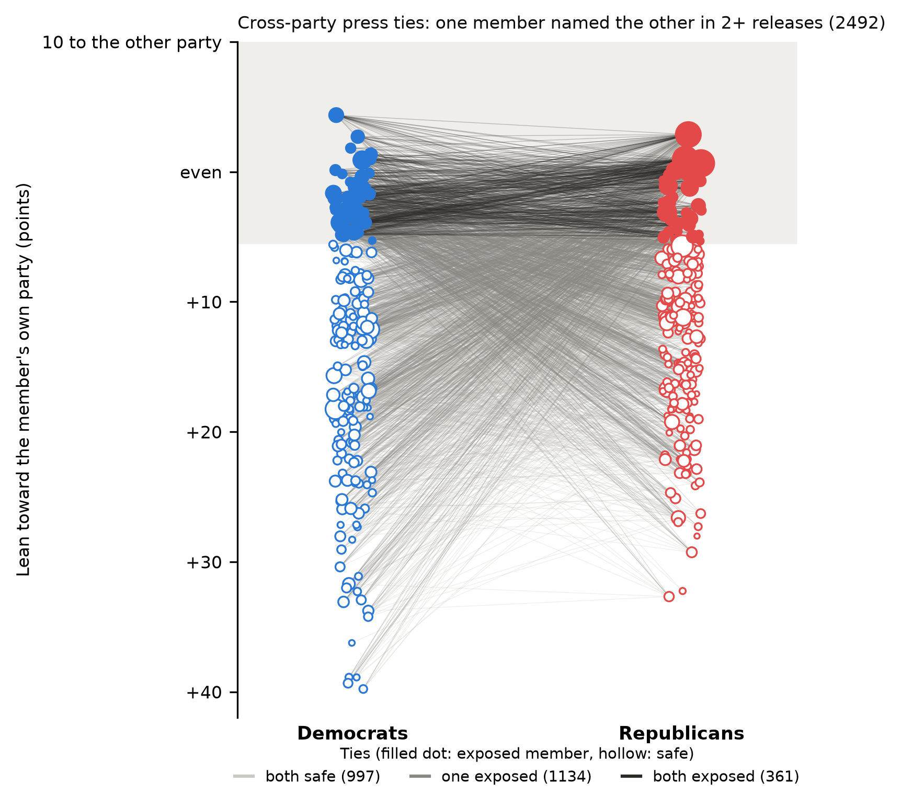

# A4: do exposed members name the other party more at home? (first run, 21 Nov)

Anas with Claude. Plan: `../methods_drafts.md`, "A4 analysis plan", written 20 Nov before any release text was
analysed. Everything below follows it; nothing in the test was chosen after seeing results.

```bash
python a4/analysis.py --press press_releases --repo <repo>   # about 10 s; writes a4/out/
python a4/figure3.py                                         # Figure 3 draft
```

**Settings, as proposed for the Sunday freeze** (STATUS; `G13_UPDATE.md`):
- **Swing seat ("exposed"):** `exposed_2025`. A member is exposed when the district they served leans toward their
  own party by 5 points or less (Cook PVI 2025), which includes seats leaning to the other party. **Republican:
  lean ≤ R+5. Democrat: lean ≤ D+5.**
- **Window:** the full snapshot, 3 Jan 2025 to 20 Nov 2026.
- **Who is in the test:** 406 members with at least 10 releases, holding 53,664 releases.

**Outcome:** the share of a member's releases that name at least one House member of the other party who is
neither a co-lead of a bill the release cites (A3.5) nor a party leader (`../a3/leaders.csv`).

## Result

| Group | Members | Mean share |
|---|---|---|
| Republicans, exposed | 37 | **13.2%** |
| Republicans, safe | 171 | 9.2% |
| Democrats, exposed | 54 | **11.5%** |
| Democrats, safe | 144 | 8.9% |

| Quantity | Value | Permutation p (10,000 shuffles within party, seed 2805) |
|---|---|---|
| Republican gap (exposed − safe) | +4.0 points | 0.004 |
| Democratic gap | +2.6 points | 0.003 |
| Interaction (R gap − D gap) | +1.4 points | 0.40 |

**Reading, by the rule fixed in advance:** the gap is positive in both parties and the interaction is near 0. That
is **"a seat effect: members in close seats show the other side, whatever their party"**, not a president's-party
effect.

**Wording for the paper** (plan: "consistent with", never "because"): *"Members in exposed seats named the other
party in more of their releases than members in safe seats, in both parties (Republicans 13.2% against 9.2%,
Democrats 11.5% against 8.9%; permutation p < 0.01 for each). The difference between the parties was small and not
distinguishable from zero (1.4 points, p = 0.40), consistent with a seat effect rather than a president's-party
effect."*

## Robustness: every row is the same test (`out/results.csv`)

| Check | R gap | p | D gap | p | Interaction | p |
|---|---|---|---|---|---|---|
| **Main: lean within 5** | **+4.0** | **0.004** | **+2.6** | **0.003** | **+1.4** | **0.40** |
| Cut-off 4 (check 4) | +6.3 | <0.001 | +2.9 | 0.002 | +3.4 | 0.06 |
| Cut-off 6 (check 4) | +3.6 | 0.006 | +2.5 | 0.002 | +1.0 | 0.50 |
| 2024 presidential margin instead of Cook | +5.5 | <0.001 | +2.9 | 0.001 | +2.6 | 0.13 |
| Without the 21 relabelled or unknown in 2026 (check 1) | +3.9 | 0.008 | +2.2 | 0.017 | +1.7 | 0.33 |
| Without redistricting releases (check 2) | +4.0 | 0.004 | +2.6 | 0.003 | +1.4 | 0.38 |
| Without caucus releases | +4.0 | 0.003 | +2.8 | 0.002 | +1.2 | 0.46 |
| Outcome with co-leads kept | +7.0 | 0.003 | +6.4 | <0.001 | +0.6 | 0.83 |
| Martin's matcher alone (no press layer) | +3.7 | 0.004 | +2.3 | 0.003 | +1.4 | 0.34 |

- **Leave one state out:** R gap +3.5 to +4.8, D gap +2.1 to +3.1, interaction +0.9 to +2.4. No single state carries
  it.
- **Lean as a number** (check 4), using every member (`figure_lean.py`, `out/figure_lean.png`):
  - **The straight-line slope is negative and significant.** Republicans −0.24 points per point of lean (p 0.003);
    Democrats −0.14 (p < 0.001).
  - **But the picture is not a straight line. It is a peak in the closest seats and a nearly flat floor beyond
    them.** Share of releases by the member's lean toward their own party (members in brackets):

    | Own-party lean | Republicans | Democrats |
    |---|---|---|
    | Leans to the other party (crossover seat) | 19.1% (8) | 14.0% (10) |
    | 0 to 5 points | 11.5% (29) | 10.9% (44) |
    | 5 to 10 | 9.7% (58) | 9.0% (29) |
    | 10 to 20 | 9.1% (85) | 9.6% (67) |
    | over 20 | 8.2% (28) | 7.8% (48) |

  - **So the gap comes mostly from the closest seats, above all the 18 crossover members**, with only a slight
    decline beyond 5 to 10 points. This is why a tighter cut-off gives a bigger gap.
  - **The crossover groups are small** (8 and 10 members), so their means are uncertain.
  - **Corrected 21 Nov:** an earlier note here said the share "falls steadily as seats get safer". The plot shows
    it does not.
- **Check 3** (before and after the new maps) was optional and is not run; it is dropped under G17 unless it is
  done by Sun 22 Nov.

**What the robustness says:** every row has a positive gap in both parties with p < 0.05, and no row has a
significant interaction. The cut-off changes **how big** the gap is, not **which way** it points. The tightest
cut-off (4) gives the largest Republican gap and the only interaction near significance (p 0.06). That is the one
hint of a president's-party effect, and it should be reported as a hint, not a finding. The plot of all members
(below) shows why the cut-off moves the size: the difference sits in the closest seats.



This plot shows every member instead of two groups, so it may serve better as Figure 3A than the current panel A.
That is a choice for the group.

## Figure 3 (draft): `out/figure3_draft.png`, `.pdf`



**Panel A replaced 21 Nov (Anas):** it now shows every member against district lean (`figure_lean.py`'s view),
not two groups. The exposed–safe strip plot is in the repository history.

**Caption draft.** *Members in the closest seats name the other party most in their press releases, in both
parties. (A) Each dot is one member (n = 406), placed by the Cook PVI 2025 of the district they served. The value is
the share of their releases naming a House member of the other party who is neither a co-lead of a bill the release
cites nor a party leader. Lines join the means of 5-point bands with at least 5 members. Shaded: within 5 points of
even, where both parties' members count as exposed. (B) The exposed minus safe gap for each party under the main definition and each robustness check; every
gap is significant at p < 0.05 by a permutation test that shuffles exposure within party.*

Not yet in it: the mutual pairs from A3.7 (Golden–Fitzpatrick, Kaptur–Fitzpatrick, Golden–Lawler). They work
better as one sentence in the text than as a third panel on a half page.

## Extension: the home network of cross-party naming (21 Nov)

The design was fixed before computing: [`HOME_NETWORK_PLAN.md`](HOME_NETWORK_PLAN.md). Scripts:
- `home_network.py`: the planned tests;
- `home_network_posthoc.py`: a degree-matched check, **post hoc**;
- `figure_network.py`: the figure.

**The network:**
- **Nodes:** the 406 members of the A4 test.
- **Ties:** A → B when A named B in a release. Leaders as the named member are left out; co-leads are kept.
- **Size:** 6,732 cross-party ties (undirected), with 2,055 mutual pairs.

**Result:**
- **Exposed members are the hubs of cross-party naming, in both directions.** They are 22% of members but **send
  35% and receive 34%** of cross-party ties, and 38% of ties named in 2+ releases.
- **They prefer each other only slightly beyond that activity.** 10.8% of cross-party ties join two exposed members.
  - **The proper null (N1, week 2):** a degree-preserving rewiring that keeps every tie cross-party and every
    member's number of ties. It gives 10.3% (95% range 9.9 to 10.7%). The observed share is **5% above it**
    (ratio 1.05, p 0.025), and S1 assortativity is above its rewired value too (−0.010 against −0.031, p 0.025).
  - **Correction (21 Nov, late):** a quick product of tie-end shares had given 10.9% and "no preference" (ratio
    0.99). That shortcut ignores that a simple graph cannot put two ties between the same pair, so for the busiest
    members it overstates what chance gives. The rewiring is the right null and replaces it.
  - **Reading:** a real but small preference, about one tie in twenty beyond activity.
- **The planned S2 test** (share of ties joining two exposed members against a within-party shuffle): ×2.2,
  p < 0.001. It **measures the hub effect, not a preference**, because that shuffle moves the label to less active
  members (see the correction in the plan).
  - **The post hoc quintile-matched check** gave ×1.11 (p 0.02). Its five activity bins are too coarse to remove
    the hub effect; the tie-end calculation above settles it.
- **Mutual naming (S3), suggestive only.**
  - Ties between two exposed members are more often mutual: 62% against 45%, p < 0.001 under the planned null and
    0.02 degree-matched.
  - But reciprocity also rises with activity. The effect fades for ties in 2+ releases (p 0.44 degree-matched) and
    with co-leads left out (p 0.09), and co-led bills and joint releases make ties mutual by construction.
- **Safe members do not cross the aisle more locally (S4).** About 11% of cross-party ties stay in the home state,
  for safe and exposed members alike (11.2% against 10.7%, p 0.76). This is null in every row.

### Centrality and communities (addendum, design fixed before computing; weeks 2 to 4)

Script `home_measures.py`; design in the addendum of `HOME_NETWORK_PLAN.md`. **Every value, formula and step: [`NETWORK_METHODS.md`](NETWORK_METHODS.md).**

**Centrality on the backbone (week 3).** Exposed minus safe within each party; p from shuffling exposure within
party (`out/home_measures_centrality.csv`):

| Measure | Republicans: exposed / safe | p | Democrats: exposed / safe | p |
|---|---|---|---|---|
| Cross-party degree (full map) | 54 / 28 | < 0.001 | 45 / 30 | < 0.001 |
| Degree (backbone) | 8.7 / 5.8 | 0.001 | 9.9 / 10.3 | 0.63 |
| Betweenness (backbone) | 0.0067 / 0.0036 (×1.9) | 0.010 | 0.0066 / 0.0067 | 0.94 |
| Closeness (backbone) | 0.317 / 0.300 | 0.005 | 0.338 / 0.335 | 0.44 |
| Betweenness given degree (residual) | −0.29 / +0.06 | 0.07 | +0.17 / −0.06 | 0.02 |

- **Republicans:** exposed members are more central on every count, but **because they have more ties**. Given their
  degree, their betweenness is, if anything, lower (p 0.07).
- **Democrats:** exposed members have no more backbone ties than safe Democrats, who are densely tied among
  themselves. But **given their ties, they sit on more shortest paths** (p 0.02).
- **After the Holm correction for the 10 tests** (`NETWORK_METHODS.md` §3d):
  - **holds:** cross-party degree in both parties (Holm p 0.001), and the Republicans' degree and closeness (0.010,
    0.034);
  - **borderline:** Republican betweenness (0.058);
  - **does not hold:** "exposed Democrats broker given their ties" (0.02 before, 0.12 after). The party difference
    in how members bridge is a hint at most, not a result.
- **Closeness hardly varies** (standard deviation 0.02 to 0.03), as expected in a dense network where most members
  are two or three steps apart. It adds little.

**Communities (week 4).** Louvain on the full weighted map, best of 50 seeds (`out/home_measures_communities.csv`,
`out/home_communities_members.csv`):
- **11 communities, modularity 0.273, NMI with party 0.22.** The home map is **not** split by party the way the
  working map is (Martin's M5: NMI 0.83).
- **Party modularity Q:** 0.151 weighted, 0.237 unweighted. It is not directly comparable to the floor (0.106) or
  working (0.211) maps: other tie definitions and densities.
- **Two party cores:** 124 members (117 R) and 101 (95 D).
- **Nine smaller, mixed communities**, mostly **state or regional delegations** across party: Florida (11 of 21);
  Maryland and Virginia (16 of 21); Washington, Oregon and Arizona; Iowa, Minnesota and North Carolina; Texas,
  Connecticut and Ohio.
- **One community is the close-seat members themselves:** 37 members, 19 R and 18 D, **19 of them exposed**, mostly
  New York and Michigan. Among them: Bacon, LaLota, Gillen, Scholten, Golden, Josh Riley, Kaptur, Cuellar, Mannion.
- **Where the exposed members sit:** in more mixed communities. On average, 36% (R) and 39% (D) of an exposed
  member's community belongs to the other party, against 24% and 23% for safe members (p 0.010 and < 0.001).

**What it adds to the story:**
- **The hubs:** the members in close seats are the hubs of the home map's cross-party ties. They name the other side
  more, and they are named by it more.
- **Each other:** beyond their activity, they tie to each other only slightly more than chance (5%).
- **A community of their own:** the community detection finds one, a 37-member bipartisan community that is half
  exposed members.
- **The parties may bridge differently** (exposed Republicans by volume, exposed Democrats by position), but this
  does not survive the Holm correction. Mention it as a hint, or leave it out.
- **The other mixed communities follow geography:** state delegations. But at the level of single ties, safe
  members are no more local than exposed ones (S4).
- **In one line:** "The vulnerable are the bridges, and a few of them form a bipartisan cluster of their own."

**Wording:** "names", not "shows" or "praises". Tone is not measured here, and some cross-party naming is
criticism. Lawler's release naming Golden, for example, criticises the Senate leader's shutdown strategy.


**Main version (21 Nov, replaces the group view): the home map** (`figure_home_map.py`), drawn with the course's
week-4 tools.
- **Network:** all ties between the 406 members, same-party and cross-party. Each tie is weighted by decision 8's
  1/n release weights.
- **Backbone:** the disparity filter at α = 0.01, which keeps 1,659 of 29,163 ties (630 cross-party) and every member
  connected. α was chosen for readability, as in 4.11.
- **Layout:** ForceAtlas2, the 4.11 recipe: 2,000 iterations, scaling 5, strong gravity, seed 11. FA2's LinLog mode
  was tried and mixed the parties more, so it was not used.
- **Reading the picture:**
  - **The two parties form two areas:** Republicans on the left, Democrats on the right. The soft shading marks
    where each party's members are densest.
  - **The exposed members (filled) sit where the areas meet.** Of each exposed member's 10 nearest neighbours in
    the drawing, 47 to 50% are from the other party, against 31 to 38% for safe members, over three layout seeds.
    This describes the drawing; it is not a test. The tests are above.
  - **Labels:** the six members with the most cross-party ties: Fitzpatrick, Bacon, Lawler, Salazar, Panetta, Costa.
- **Panel B** gives the plain numbers: cross-party ties per member, 45 and 54 for exposed members against 30 and 28
  for safe ones.

**Caption draft (home map).** *The home map: who names whom in press releases. (A) Each dot is one member (n = 406), placed by ForceAtlas2 on the backbone of ties where one named the other (disparity filter, α = 0.01; dark: across the aisle, light: within a party). Filled dots are members in exposed seats, hollow dots members in safe seats; dot size is the member's number of cross-party ties. Black rings mark the 37 members of the close-seat community that Louvain finds. (B) Louvain communities on the full weighted map, by party, with the number of exposed members in each. (C) Members of the other party that each member names or is named by, on average.*

**Group view (an earlier draft, kept for the slides).** Feedback: its densities ("36% of pairs") read as
contradicting the tie counts next to them. It is kept only as a simpler slide version, `figure_network_groups.py`.
- **Ties per member:** exposed Democrats and Republicans have 45 and 54 cross-party ties each; safe Democrats and
  Republicans 30 and 28.
- **Share of possible pairs that are tied:** 12% between two safe groups, 19% and 24% with one exposed group, 36%
  between the two exposed groups.
- **How to read the 36%:** most of it is the two groups' activity. The degree-preserving null puts the
  preference beyond that at about 5% (see above).

**Caption draft (group view).** *Who names whom across the aisle in press releases. Circles: exposed (filled) and
safe (hollow) members of each party; circle area follows the number of members. The percentage on each link is the
share of possible member pairs between the two groups where one named the other at least once; link width follows
it. Members in exposed seats have about 1.6 times as many cross-party ties as members in safe seats, and the chance
that two members are tied rises with each exposed end, mostly because of that activity.*

**For the Discussion (an interpretation, not a finding):** the gap is consistent with different electoral
incentives. Members in close seats face a general election where swing voters may reward naming the other side;
members in safe seats face mainly primaries, where it may cost them. We do not measure motives.

**Detailed version (members as dots), kept for the slides or appendix:**



**Caption draft (detailed view).** *Cross-party press ties among the 406 members: a line joins two members of different parties
when one named the other in at least two releases (2,492 ties). Members are placed by how safe their seat is
(crossover and close seats at the top, shaded: exposed). Filled dots are exposed members and hollow dots safe
members; dot size is the number of cross-party ties. Exposed members are a fifth of the members but take part in
more than a third of the ties.*

**Space:** part 3 has about half a page. Figure 3 fits; this figure most likely does not. The extension is two
sentences in Results, with the figure in the repository or the slides.

## Limits to state

- **Observational.** Exposed members may also differ in seniority, committee, or how much bipartisan legislation
  they write. The test says exposed and safe differ, not why.
- **The matcher.** Press recall is 0.97 and precision 0.96 (A3.4), and the result holds with Martin's matcher alone.
- **AI checks.** The recall and bill checks used blind AI readers, with Anas checking every disagreement
  (`../a3/README.md`).
- **The window and the swing-seat definition** are the proposals for the Sunday freeze. If the group changes them,
  rerun these two scripts (seconds).
