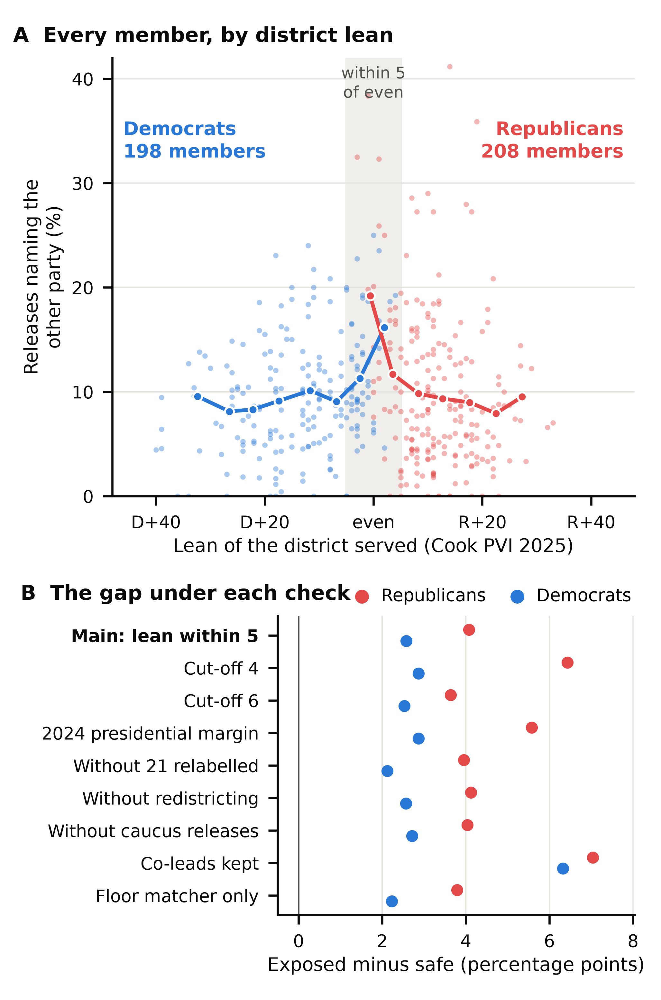
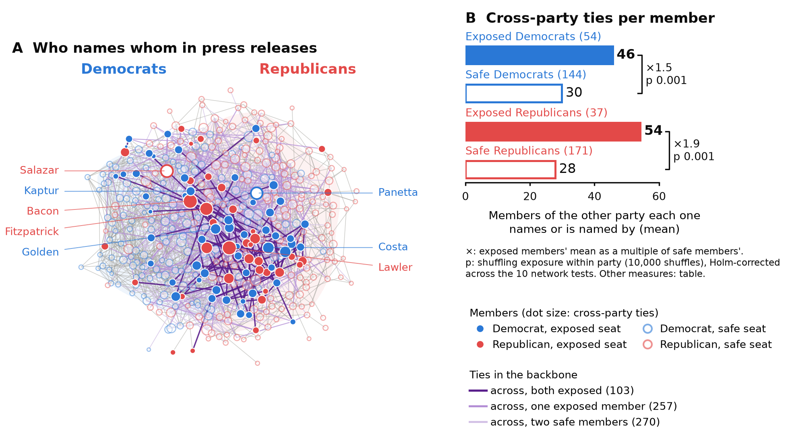

# A4: do exposed members name the other party more at home? (first run 21 Nov; rerun 22 Nov)

> **25 Nov: final.** The group accepted the home map (and A5) into the paper, and the analysis is closed: no new
> analyses from here on. Part 3's text is `../results_part3.tex`; the folder overview is `../README.md`. Status
> lines below were updated in place on 25 Nov; the analyses and numbers are unchanged.

> **Rerun 22 Nov on Martin's 22 Nov matcher** (possessives, middle initials): every number below is the rerun's.
> Old against new, and what changed: [`../RERUN_22NOV.md`](../RERUN_22NOV.md). Every reading holds; one correction
> (Republican closeness no longer survives Holm).

Anas with Claude. Plan: `../methods_drafts.md`, "A4 analysis plan", written 20 Nov before any release text was
analysed. Everything below follows it; nothing in the test was chosen after seeing results.

```bash
python a4/analysis.py --press press_releases --repo <repo>   # about 10 s; writes a4/out/
python -I a4/figure3_column.py                               # Figure 3 for the paper: one column, out/figure3.pdf
```

**Settings** (Anas's G13 proposal, agreed by Martin 23 Nov; text for `DECISIONS.md` in `../G13_UPDATE.md`):
- **Swing seat ("exposed"):** `exposed_2025`. A member is exposed when the district they served leans toward their
  own party by 5 points or less (Cook PVI 2025), which includes seats leaning to the other party. **Republican:
  lean ≤ R+5. Democrat: lean ≤ D+5.**
- **Window:** the full snapshot, 3 Jan 2025 to 20 Nov 2026.
- **Who is in the test:** 406 members with at least 10 releases, holding 53,664 releases.

**Outcome:** the share of a member's releases that name at least one House member of the other party who is
neither a co-lead of a bill the release cites (A3.5) nor a party leader (`../a3/leaders.csv`).

## Result

| Group | Members | Mean share |
|---|---|---|
| Republicans, exposed | 37 | **13.3%** |
| Republicans, safe | 171 | 9.2% |
| Democrats, exposed | 54 | **11.6%** |
| Democrats, safe | 144 | 9.0% |

| Quantity | Value | Permutation p (10,000 shuffles within party, seed 2805) |
|---|---|---|
| Republican gap (exposed − safe) | +4.1 points | 0.004 |
| Democratic gap | +2.6 points | 0.004 |
| Interaction (R gap − D gap) | +1.5 points | 0.36 |

**Reading, by the rule fixed in advance:** the gap is positive in both parties and the interaction is near 0. That
is **"a seat effect: members in close seats show the other side, whatever their party"**, not a president's-party
effect.

**Wording for the paper** (plan: "consistent with", never "because"): *"Members in exposed seats named the other
party in more of their releases than members in safe seats, in both parties (Republicans 13.3% against 9.2%,
Democrats 11.6% against 9.0%; permutation p < 0.01 for each). The difference between the parties was small and not
distinguishable from zero (1.5 points, p = 0.36), consistent with a seat effect rather than a president's-party
effect."*

## Robustness: every row is the same test (`out/results.csv`)

| Check | R gap | p | D gap | p | Interaction | p |
|---|---|---|---|---|---|---|
| **Main: lean within 5** | **+4.1** | **0.004** | **+2.6** | **0.004** | **+1.5** | **0.36** |
| Cut-off 4 (check 4) | +6.4 | <0.001 | +2.9 | 0.002 | +3.6 | 0.051 |
| Cut-off 6 (check 4) | +3.6 | 0.006 | +2.5 | 0.003 | +1.1 | 0.48 |
| 2024 presidential margin instead of Cook | +5.6 | <0.001 | +2.9 | 0.001 | +2.7 | 0.12 |
| Without the 21 relabelled or unknown in 2026 (check 1) | +4.0 | 0.007 | +2.1 | 0.019 | +1.8 | 0.29 |
| Without redistricting releases (check 2) | +4.1 | 0.004 | +2.6 | 0.004 | +1.6 | 0.35 |
| Without caucus releases | +4.0 | 0.003 | +2.7 | 0.002 | +1.3 | 0.42 |
| Outcome with co-leads kept | +7.0 | 0.003 | +6.3 | <0.001 | +0.7 | 0.80 |
| Martin's matcher alone (no press layer) | +3.8 | 0.003 | +2.2 | 0.003 | +1.6 | 0.29 |

- **Leave one state out:** R gap +3.6 to +4.9, D gap +2.1 to +3.1, interaction +1.0 to +2.5. No single state carries
  it.
- **Lean as a number** (check 4), using every member (`figure_lean.py`, `out/figure_lean.png`):
  - **The straight-line slope is negative and significant.** Republicans −0.24 points per point of lean (p 0.003);
    Democrats −0.14 (p < 0.001).
  - **But the picture is not a straight line. It is a peak in the closest seats and a nearly flat floor beyond
    them.** Share of releases by the member's lean toward their own party (members in brackets):

    | Own-party lean | Republicans | Democrats |
    |---|---|---|
    | Leans to the other party (crossover seat) | 19.2% (8) | 14.2% (10) |
    | 0 to 5 points | 11.7% (29) | 11.0% (44) |
    | 5 to 10 | 9.8% (58) | 9.2% (29) |
    | 10 to 20 | 9.2% (85) | 9.7% (67) |
    | over 20 | 8.2% (28) | 7.9% (48) |

  - **So the gap comes mostly from the closest seats, above all the 18 crossover members**, with only a slight
    decline beyond 5 to 10 points. This is why a tighter cut-off gives a bigger gap.
  - **The crossover groups are small** (8 and 10 members), so their means are uncertain.
  - **Corrected 21 Nov:** an earlier note here said the share "falls steadily as seats get safer". The plot shows
    it does not.
- **Check 3** (before and after the new maps) was optional and is not run; it is dropped under G17 unless it is
  done by Sun 22 Nov.

**What the robustness says:** every row has a positive gap in both parties with p < 0.05, and no row has a
significant interaction. The cut-off changes **how big** the gap is, not **which way** it points. The tightest
cut-off (4) gives the largest Republican gap and the only interaction near significance (p 0.051). That is the one
hint of a president's-party effect, and it should be reported as a hint, not a finding. The plot of all members
(below) shows why the cut-off moves the size: the difference sits in the closest seats.


This plot is now Figure 3A (decided 21 Nov).

## Check I, 23 Nov: is "exposed" just "moderate"? (`ideology_check.py`, `out/ideology_check.csv`)

Design fixed and approved before computing: [`CHECKS_PLAN_23NOV.md`](CHECKS_PLAN_23NOV.md). The week 3 logic ("the
part of your effect that degree already explained"), with ideology (DW-NOMINATE dim1, all 406 members) in place of
degree: the exposed label is shuffled only among members of the same party and ideology band. One run, 10,000
shuffles, seed 2805. Null A, rerun here, reproduces A4 (p 0.0037 and 0.0041 against 0.0035 and 0.0036).

| Party | Observed gap | Gap expected from ideology alone (null B, quintiles) | Beyond ideology | p | Terciles: expected, beyond, p |
|---|---|---|---|---|---|
| Republicans | +4.08 points | +2.94 | +1.14 | 0.39 | +2.78, +1.30, 0.34 |
| Democrats | +2.58 | +2.36 | +0.22 | 0.76 | +2.15, +0.43, 0.56 |

- **Reading, by the rule fixed in advance:** "not distinguishable in either party". Exposure and moderation cannot
  be separated with these data. About three quarters of the Republican gap and nine tenths of the Democratic gap
  is what ideology alone would give.
- **Why:** exposure and moderation nearly coincide. 22 of the 37 exposed Republicans and 27 of the 54 exposed
  Democrats are in their party's most moderate fifth; the most extreme fifth holds 3 and 2. Within a band there
  are few exposed members to compare, so the test has little power, and the remaining gap (+1.1 and +0.2 points)
  is small.
- **What it does not say:** that ideology *causes* the naming. NOMINATE comes from roll-call votes, and members in
  swing seats may vote moderately *because* of the seat, so holding it fixed can remove part of a real seat effect
  (known in advance; this test is the strict one). The honest statement is that seat and ideology go together and
  this design cannot tell which one drives the naming.
- **For part 3:** "consistent with a seat effect, which we cannot separate from ideology" (the fixed wording), and
  the Discussion names it as a limitation.

## Check T, 23 Nov: what do the counted names do? (`make_tone.py`, `score_tone.py`, `check_tone/`)

Design fixed and approved before the draw: [`CHECKS_PLAN_23NOV.md`](CHECKS_PLAN_23NOV.md). 60 of the exact
mentions A4 counts (other party, not a co-lead, not a leader), 15 per party × seat cell, member drawn first; three
blind AI readers (two Opus, one Sonnet) who never saw the seat or the cell. Agreement 56 of 60 (pairwise 93–98%).

| | P partner or praise | C criticised | M mentioned only | N wrong match |
|---|---|---|---|---|
| Exposed (30) | 24 (80%) | 0 | 4 | 2 |
| Safe (30) | 22 (73%) | 1 | 5 | 2 |
| **All 60** | **46 (77%, 95% 65–86%)** | **1 (2%, 0–9%)** | 9 (15%) | 4 (7%) |

- **Reading, by the rule fixed in advance:** C is 25% or less in every cell (at most 1 of 15), so the names A4
  counts are mostly partnership: "name" stands, and the Discussion can say most named members are partners.
  Exposed and safe seats do not differ in C (R −6.7 points, D 0; p 1.00).
- **The one C:** Biggs (R, safe) on Raskin's remarks. Closest calls to C, coded M by all three: two Democratic
  letters to Republican committee chairs quoting their past words (t_02, t_45).
- **N, 4 of 60:** "Hudson Valley", a veteran named Tim Kennedy, "James R. Walkinshaw", the statesman Daniel Webster.
  A second precision estimate for the A4 outcome: 56 of 60 right (0.93, 95% 0.84–0.97), against 0.96 in A3's check.
- **Disagreements:** 4, all P against M (`check_tone/DIFFERENCES.md`). **Anas read all four on 23 Nov**
  (`check_tone/anas_codes.csv`): t_50 P, t_52 M, t_58 P, t_60 P. Two moved (t_50 M → P, t_52 P → M, both
  exposed Republicans), so every count in the table above is unchanged. Final codes: Anas's for these four, the
  readers' unanimous code for the other 56.

## Figure 3: `out/figure3.pdf` (in the paper as `report/figures/figure3.pdf`)

**23 Nov:** remade for one PNAS column (`figure3_column.py`, 8.7 × 15 cm, panel A above B, fonts 6–7.5 pt at print
size, checked for overlapping labels), because the paper places Figure 3 in one column, where the earlier
side-by-side draft would print its text at about 3 pt. Same data and encodings. Caption: `../figure3_caption.tex`.
The side-by-side draft (`figure3.py`, `figure3_draft.*`) was removed on 25 Nov; it is in the git history.



**Panel A replaced 21 Nov (Anas):** it now shows every member against district lean (`figure_lean.py`'s view),
not two groups. The exposed–safe strip plot is in the repository history.

**Caption:** the final one is `../figure3_caption.tex` (23 Nov), the same as in `report/sections/results.tex`.

Not in it: the mutual pairs from A3.7 (Golden–Fitzpatrick, Kaptur–Fitzpatrick, Golden–Lawler). They work
better as one sentence in the text than as a third panel on a half page.

## Extension: the home network of cross-party naming (21 Nov)

The design was fixed before computing: [`HOME_NETWORK_PLAN.md`](HOME_NETWORK_PLAN.md). Scripts:
- `home_network.py`: the planned tests;
- `home_network_posthoc.py`: a degree-matched check, **post hoc**;
- `figure_home_map.py`: the figure (below; the earlier drafts `figure_network.py` and `figure_network_groups.py`
  were removed on 25 Nov and are in the git history).

**The network:**
- **Nodes:** the 406 members of the A4 test.
- **Ties:** A → B when A named B in a release. Leaders as the named member are left out; co-leads are kept.
- **Size:** 6,765 cross-party ties (undirected), with 2,060 mutual pairs.

**Result:**
- **Exposed members are the hubs of cross-party naming, in both directions.** They are 22% of members but **send
  35% and receive 34%** of cross-party ties, and 38% of ties named in 2+ releases.
- **They prefer each other only slightly beyond that activity.** 10.7% of cross-party ties join two exposed members.
  - **The proper null (N1, week 2):** a degree-preserving rewiring that keeps every tie cross-party and every
    member's number of ties. It gives 10.2% (95% range 9.8 to 10.6%). The observed share is **5% above it**
    (ratio 1.05, p 0.015), and S1 assortativity is above its rewired value too (−0.011 against −0.032, p 0.015).
  - **Correction (21 Nov, late):** a quick product of tie-end shares had given 10.9% and "no preference" (ratio
    0.99). That shortcut ignores that a simple graph cannot put two ties between the same pair, so for the busiest
    members it overstates what chance gives. The rewiring is the right null and replaces it.
  - **Reading:** a real but small preference, about one tie in twenty beyond activity.
- **The planned S2 test** (share of ties joining two exposed members against a within-party shuffle): ×2.2,
  p < 0.001. It **measures the hub effect, not a preference**, because that shuffle moves the label to less active
  members (see the correction in the plan).
  - **The post hoc quintile-matched check** gave ×1.12 (p 0.014). Its five activity bins are too coarse to remove
    the hub effect; the tie-end calculation above settles it.
- **Mutual naming (S3), suggestive only.**
  - Ties between two exposed members are more often mutual: 62% against 45%, p < 0.001 under the planned null and
    0.014 degree-matched.
  - But reciprocity also rises with activity. The effect fades for ties in 2+ releases (p 0.45 degree-matched) and
    with co-leads left out (p 0.09), and co-led bills and joint releases make ties mutual by construction.
- **Safe members do not cross the aisle more locally (S4).** About 11% of cross-party ties stay in the home state,
  for safe and exposed members alike (11.1% against 10.7%, p 0.79). This is null in every row.

### Centrality and communities (addendum, design fixed before computing; weeks 2 to 4)

Script `home_measures.py`; design in the addendum of `HOME_NETWORK_PLAN.md`. **Every value, formula and step: [`NETWORK_METHODS.md`](NETWORK_METHODS.md).**

**Centrality on the backbone (week 3).** Exposed minus safe within each party; p from shuffling exposure within
party (`out/home_measures_centrality.csv`):

| Measure | Republicans: exposed / safe | p | Democrats: exposed / safe | p |
|---|---|---|---|---|
| Cross-party degree (full map) | 54 / 28 | < 0.001 | 46 / 30 | < 0.001 |
| Degree (backbone) | 8.6 / 5.7 | 0.002 | 9.8 / 10.3 | 0.57 |
| Betweenness (backbone) | 0.0067 / 0.0037 (×1.8) | 0.010 | 0.0065 / 0.0066 | 0.91 |
| Closeness (backbone) | 0.316 / 0.300 | 0.008 | 0.337 / 0.335 | 0.52 |
| Betweenness given degree (residual) | −0.25 / +0.05 | 0.12 | +0.18 / −0.07 | 0.016 |

- **Republicans:** exposed members are more central on every count, but **because they have more ties**. Given their
  degree, their betweenness is, if anything, lower (p 0.12).
- **Democrats:** exposed members have no more backbone ties than safe Democrats, who are densely tied among
  themselves. But **given their ties, they sit on more shortest paths** (p 0.016).
- **After the Holm correction for the 10 tests** (`NETWORK_METHODS.md` §3d):
  - **holds:** cross-party degree in both parties (Holm p 0.001), and the Republicans' backbone degree (0.013);
  - **borderline:** Republican closeness (0.055) and betweenness (0.059). **Corrected 22 Nov:** on the 21 Nov run
    closeness held (0.034); after the rerun it does not;
  - **does not hold:** "exposed Democrats broker given their ties" (0.016 before, 0.08 after). The party difference
    in how members bridge is a hint at most, not a result.
  - **α-dependent (checked 22 Nov, `alpha_centrality.py`):** every comparison points the same way at α from 0.005
    to 0.2 (sizes shift a little: Republican betweenness 2.1× to 1.6×), but Republican betweenness and closeness and the Democrats' brokering pass Holm
    at every α from 0.02 up. α = 0.01 stays the main setting (chosen before the check); see `NETWORK_METHODS.md` §3d.
- **Closeness hardly varies** (standard deviation 0.02 to 0.03), as expected in a dense network where most members
  are two or three steps apart. It adds little.

**Communities (week 4).** Louvain on the full weighted map, best of 50 seeds (`out/home_measures_communities.csv`,
`out/home_communities_members.csv`):
- **11 communities, modularity 0.272, NMI with party 0.20.** The home map is **not** split by party the way the
  working map is (Martin's M5: NMI 0.83).
- **Party modularity Q:** 0.152 weighted, 0.237 unweighted. It is not directly comparable to the floor (0.106) or
  working (0.211) maps: other tie definitions and densities.
- **Two party cores:** 120 members (112 R) and 95 (89 D).
- **Nine smaller, mixed communities**, mostly **state or regional delegations** across party: Texas, Florida and Connecticut
  (52); Minnesota, North Carolina and Ohio (31); Maryland and Virginia (16 of 23); Washington, Oregon and Arizona;
  Florida and Nevada; and a second, small close-seat group in California and Hawaii (10 members, 5 exposed: Costa,
  Gray, Harder, Kim, Valadao).
- **One community is the close-seat members themselves:** 35 members, 17 R and 18 D, **19 of them exposed**, mostly
  New York and Michigan (21 Nov: 37; Malliotakis, Latta and Matsui left it, McBride joined). Among them: Bacon, LaLota, Gillen, Scholten, Golden, Josh Riley, Kaptur, Cuellar, Mannion.
- **Where the exposed members sit:** in more mixed communities. On average, 37% (R) and 39% (D) of an exposed
  member's community belongs to the other party, against 26% and 26% for safe members (p 0.012 and 0.002).

**What it adds to the story:**
- **The hubs:** the members in close seats are the hubs of the home map's cross-party ties. They name the other side
  more, and they are named by it more.
- **Each other:** beyond their activity, they tie to each other only slightly more than chance (5%).
- **A community of their own:** the community detection finds one, a 35-member bipartisan community that is more
  than half exposed members (19).
- **The parties may bridge differently** (exposed Republicans by volume, exposed Democrats by position), but this
  does not survive the Holm correction at α 0.01. **In the paper (23 Nov text, kept 25 Nov):** part 3 reports it as
  the network's twist, with its Holm values and "we did not test why".
- **The other mixed communities follow geography:** state delegations. But at the level of single ties, safe
  members are no more local than exposed ones (S4).
- **In one line:** "The vulnerable are the bridges, and a few of them form a bipartisan cluster of their own."

**Wording:** "names", not "shows" or "praises". Tone is not measured here, and some cross-party naming is
criticism. Lawler's release naming Golden, for example, criticises the Senate leader's shutdown strategy.



**Main version (21 Nov, replaces the group view; panels redesigned 22 Nov): the home map** (`figure_home_map.py`), drawn with the course's
week-4 tools.
- **Network:** all ties between the 406 members, same-party and cross-party. Each tie is weighted by decision 8's
  1/n release weights.
- **Backbone:** the disparity filter at α = 0.01, which keeps 1,656 of 29,210 ties (630 cross-party) and every member
  connected. α was chosen by eye on 21 Nov; the 22 Nov sweep shows it is the strictest α that keeps every member in
  one component (`NETWORK_METHODS.md` §1, `alpha_sweep.py`).
- **Layout:** ForceAtlas2, the 4.11 recipe: 2,000 iterations, scaling 5, strong gravity, seed 11. FA2's LinLog mode
  was tried and mixed the parties more, so it was not used.
- **Reading the picture:**
  - **The two parties form two areas:** Democrats on the left, Republicans on the right (corrected 22 Nov: this line
    had them the other way round). The soft shading marks
    where each party's members are densest.
  - **The exposed members (filled) sit where the areas meet.** Of each exposed member's 10 nearest neighbours in
    the drawing, 46 to 50% are from the other party, against 30 to 41% for safe members, over three layout seeds.
    This describes the drawing; it is not a test. The tests are above.
  - **Labels:** the six members with the most cross-party ties (Fitzpatrick, Bacon, Lawler, Salazar, Panetta, Costa)
    and the other halves of the mutual pairs (Golden, Kaptur).
- **Redesign, third version (22 Nov, late; Anas's choices, after two rounds):**
  - **A, ties:** grey = within a party (stronger than before), purple = across the aisle (red + blue), darker the
    more exposed members a tie joins: both exposed (103 in the backbone), one exposed (257), two safe members (pale
    purple, 270); within a party 1,026. Counts are in the legend.
  - **A, names:** in two columns at the sides of the map, each joined to its member's dot by a thin line in party
    colour, so no name sits on the network. The labelled members are drawn on top so their own dots show.
  - **B, plain bars:** cross-party ties per member, exposed and safe, by party (46 against 30, 54 against 28; ×1.5
    and ×1.9, Holm p 0.001). It is the one network result that holds in both parties, after Holm and at every α.
  - **The other measures are a table**, not a panel: `table_home_measures.py` writes `out/table_home_measures.md`
    and `.tex` (backbone degree, betweenness, closeness, betweenness given degree, other-party share of community,
    the rewiring null, and at which α each passes Holm).
  - **Dropped along the way:** community rings (members scattered over the map, because the layout uses the
    backbone and Louvain the full map), a panel of per-measure dumbbells and a shared ratio scale (both hard to read).

**Caption draft (home map, 22 Nov, third version).** *Who names whom in press releases. (A) Each dot is one member
(n = 406), placed by ForceAtlas2 on the backbone of naming ties (disparity filter, α = 0.01, the strictest level that
keeps every member connected). Filled dots: members in exposed seats; faded hollow dots: safe seats; dot size: number
of cross-party ties. Purple lines are ties across the aisle, darkest between two exposed members; grey lines are ties
within a party. (B) Members of the other party each member names or is named by, on average: exposed members have 1.5
(Democrats) and 1.9 (Republicans) times as many as safe members (p = 0.001 by shuffling exposure within party,
Holm-corrected). Other network measures: Table X.*

**Group-level numbers** (first shown in the group-view draft, removed 25 Nov with its script; recomputed 25 Nov from
`out/home_ties.csv` and `out/member_shares.csv`, same values: 3,016 of 171 × 144 safe–safe pairs, 1,743 exposed D–safe R,
1,283 safe D–exposed R, 723 of 37 × 54 exposed–exposed):
- **Ties per member:** exposed Democrats and Republicans have 46 and 54 cross-party ties each; safe Democrats and
  Republicans 30 and 28.
- **Share of possible pairs that are tied** (unchanged by the 22 Nov rerun): 12% between two safe groups, 19% and 24% with one exposed group, 36%
  between the two exposed groups.
- **How to read the 36%:** most of it is the two groups' activity. The degree-preserving null puts the
  preference beyond that at about 5% (see above).

**For the Discussion (an interpretation, not a finding):** the gap is consistent with different electoral
incentives. Members in close seats face a general election where swing voters may reward naming the other side;
members in safe seats face mainly primaries, where it may cost them. We do not measure motives.

**In the paper (25 Nov):** the home map is part 3's network paragraph (text only). The figure above and
`out/table_home_measures.tex` are ready for the slides or an appendix if the split makes room; the paper has
three figures now.

## Limits to state

- **Observational.** Exposed members may also differ in seniority, committee, or how much bipartisan legislation
  they write. The test says exposed and safe differ, not why.
- **The matcher.** Press recall is 0.97 and precision 0.96 (A3.4), and the result holds with Martin's matcher alone.
- **AI checks.** The recall and bill checks used blind AI readers, with Anas checking every disagreement
  (`../a3/README.md`).
- **The window and the swing-seat definition** are Anas's G13 proposal (agreed by Martin 23 Nov; to paste into
  `DECISIONS.md` from `../G13_UPDATE.md`). If they ever changed, rerun `analysis.py` and the scripts after it.

## Not done, and not to be done (25 Nov)

- **The committee test of the network twist** (sorting counted cross-party names by route: same committee, release
  about a bill, other). It was planned on 23 Nov to wait for the group's decision on the home map. On 25 Nov the
  group closed the analysis (no new analyses), so it is not run. Part 3 says "We did not test why" and names the
  majority's control of committees only as one possibility.
- **Check 3** (before and after the new maps) was dropped under G17 on 22 Nov.
