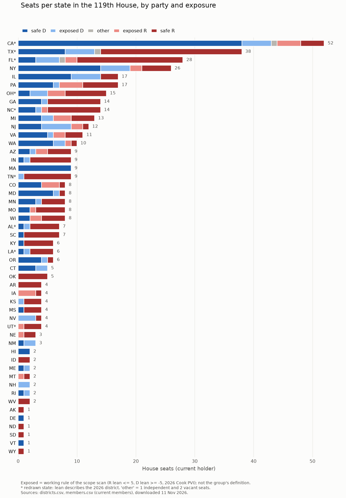

# Seats per state

Anas, 19 November 2026. One run of `state_seats.py` on the repo's `districts.csv` and `members.csv` (downloaded
11 Nov 2026) and the press-release counts in `../press_scope/scope_by_member.csv` (18 Nov 2026).



Table: [`seats_by_state.csv`](seats_by_state.csv), one row per state: seats, holders by party, exposed seats by
party, median lean, redrawn or not, share of the House, releases counted per party.

```
python Anas/state_seats/state_seats.py data/processed Anas/press_scope/scope_by_member.csv Anas/state_seats
```

## How seats are spread

The House has 435 voting seats, one per district. Seats are shared out between the 50 states by population, so
a state's delegation can be anything from 1 to 52 seats.

| | |
|---|---|
| Seats held on 11 Nov 2026 | 218 R, 214 D, 1 independent, 2 vacant (FL-20, TX-23) |
| Largest delegations | California 52, Texas 38, Florida 28, New York 26: together 144 seats, 33% of the House |
| One seat | Alaska, Delaware, North Dakota, South Dakota, Vermont, Wyoming |
| Median delegation | 6 seats |
| States with members of both parties | 29 of 50. 15 delegations of 2 or more seats are all one party (Massachusetts all D, Oklahoma all R, ...) |

## Exposed seats

Using the scope scan's working rule (a Republican in a district with lean ≤ 5, a Democrat with lean ≥ −5; not
the group's definition):

| | Republicans | Democrats |
|---|---|---|
| Exposed seats | 38 | 60 |
| States that have at least one | 18 | 28 |
| Share held by the 4 states with the most | 37% | 33% |
| In a redrawn state | 11 | 21 |

Exposed seats are less concentrated than seats overall. No state has more than 5 for either party (exposed
Republicans: Pennsylvania and California 4 each; exposed Democrats: California, New Jersey, Illinois, Texas and
New York 5 each).

Nine states were redrawn before 2026 (AL, CA, FL, LA, NC, OH, TN, TX, UT). They hold 173 seats, 40% of the House,
and a third of the exposed seats. In those states the lean in `districts.csv` describes the 2026 district, so
the exposed/safe label is unreliable there until the swing-seat rule uses the old district (G13, open point 2).

Of the members whose releases could be counted, 10 exposed Republicans and 21 exposed Democrats are in redrawn
states. (An earlier version of `press_scope/README.md` and of the G13 draft said 12 Republicans, counting
LaMalfa, who left office, and Max Miller, whose listing was not found. Both are corrected.)

## Press releases by state

California's Democrats posted 6,112 releases since 3 Jan 2025, nearly three times as many as the next state
(New York's Democrats, 2,216) and the largest Republican delegation by releases (Florida, 2,134). The four largest states account for 10,823 of 32,709 Democratic releases and 6,280 of
22,737 Republican ones. (The totals leave out the six delegates, 1,301 releases, which is why they are below the
scan's 56,747.)

## What the state layer is useful for

It is a check on the party comparison, not a new question.

1. **Sampling the first 20 and the 60.** If members are drawn by exposure alone, California and New York could
   supply a large part of the Democratic side. Spreading the sample over states keeps one state from driving
   the result.
2. **Count per member, not per release.** A pooled share over all releases would be weighted towards the
   members and states that post most. A share per member, then the median or mean across members, gives every
   member one vote.
3. **Leave one state out.** Rerun the exposed-against-safe gap without California, then without each other
   large state. If the gap only exists with one state in, that is worth one sentence in the paper.
4. **Same-state naming (untested).** Members of one delegation share local news, home-state projects and
   disaster funding, so a Republican may name a Democrat from the same state for local reasons, not to look
   bipartisan. In A3 each named colleague can be marked same-state or not, at no extra cost. Whether this
   matters in our data has not been checked; the three mutual pairs in the pilot are all from different states
   (Golden ME, Lawler NY, Fitzpatrick PA, Kaptur OH).

## Limits

- Seat holders are the members marked current on 11 Nov 2026. A seat that changed hands during the term is
  shown with its latest holder.
- "Exposed" uses the 2026 lean, with the redrawn-state problem above.
- Release counts are from one run of the scope scan; 43 members could not be counted.
